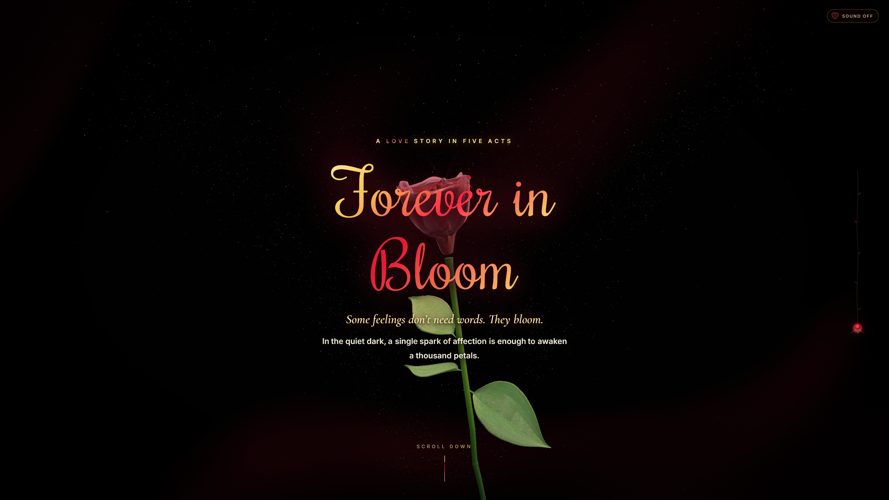

# 🌹 Forever in Bloom — A Botanical 3D Love Story

> An interactive, scroll-driven WebGL journey exploring the poetry of love through real-time botany, procedural GLSL shaders, and creative storytelling.

<p align="center">
  
</p>

<p align="center">
  <a href="https://forever-in-bloom.vercel.app"></a>
  
  
  
  
</p>

---

## ✨ Experience Highlights

### 🌿 1. Living Rose Plant Scroller (Bottom-to-Top)
Replaces native browser scrollbars with an organic, living botanical vine:
- **Rooted Base**: Anchored in a botanical root mound at the viewport bottom.
- **Climbing Vine & Trifoliate Foliage**: The stem grows upwards with scroll progress, unfurling realistic compound leaves with translucent lateral veins.
- **Multiple Blooming Roses Along the Vine**: Side garden rosebuds at Acts II, III, and IV that unfurl as love awakens.
- **Grand Apex Rose**: A 4-tiered velvet blossom at the tip with golden pollen filaments and sparkling radiance.
- **Interactive Chapter Tooltips**: Hover over leaf nodes to preview story chapters; click to glide smoothly with Lenis inertia.

### 🌹 2. Procedural Petal Bloom & Breathing Physics
- Custom GLSL vertex displacement unfolds unrigged 3D rose petals dynamically from a tightly closed bud into lush bloom.
- Specular dewdrop refraction and gentle harmonic breathing motion.

### 💐 3. 16-Rose Dome Bouquet & Large Waving Jasmine
- Fanned-out 16-rose hand-tied dome bouquet with eucalyptus foliage collar and champagne satin bow.
- Large 3D jasmine flowers with real-touch ivory petals, procedural micro-veining, and organic vertex-shader breeze waves.

### 🔮 4. Couple Love Calculator & 3D Crystalized Plasma Ball
- Liquid glass oracle card where couples enter their names.
- Triggers a full-screen rose petal and golden confetti explosion.
- Swirling 3D OGL crystalized plasma heart ball with crimson energy rays and personalized destiny poetry.

---

## 🚀 Quick Start

```bash
# Clone the repository
git clone https://github.com/your-username/forever-in-bloom.git
cd forever-in-bloom

# Install dependencies
npm install

# Start local development server
npm run dev
```

Open [http://localhost:5173/](http://localhost:5173/) in your browser and scroll slowly.

---

## 🛠️ Architecture & Tech Stack

| Layer | Technologies |
| :--- | :--- |
| **3D Rendering** | Three.js, React Three Fiber (`@react-three/fiber`), `@react-three/drei` |
| **Post-Processing** | `@react-three/postprocessing` (Selective Bloom, Depth of Field, Vignette) |
| **Animation & Physics** | GSAP ScrollTrigger, Lenis smooth inertia scroll |
| **2D / Shaders** | Custom GLSL vertex & fragment shaders, OGL Raymarched Plasma Ball |
| **Build & Tooling** | Vite 6, Tailwind/CSS3 custom variables, Puppeteer & FFmpeg recording pipeline |

---

## 🎬 Cinematic Video & Screenshots

- **Full HD 1080p Showcase Video**: [`forever_in_bloom_cinematic_showcase.mp4`](forever_in_bloom_cinematic_showcase.mp4)
- **4K Screenshots Gallery**: Available under [`public/screenshots/`](public/screenshots/)

---

<p align="center">
  Crafted with care & love 🌹
</p>
